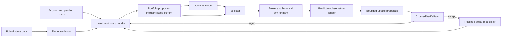

# Policy–Outcome RSI v0.2 Design

**Status:** proposed architecture approved in chat on 2026-10-14; this document is the reviewable specification before implementation planning.

**Project:** `stock-rsi-lab`

**License decision:** project-owned code will use Apache-2.0. Third-party data, models and source references keep their own terms.

## Purpose

Build an A-share research system that can improve a persistent investment workflow from historically available evidence while preserving causal time, complete lineage and fair controls.

The system must answer three separate questions:

1. Does an investment policy produce useful portfolio proposals after realistic costs and constraints?
2. Does an outcome predictor improve selection among proposals under the same external-feedback budget?
3. Does the improvement procedure produce better retained policy–predictor pairs than equal-budget non-agent search?

An engineering-complete run is not evidence that any of these claims is true. Each claim receives its own baselines and evaluation record.

## Scope

v0.2 extends the existing point-in-time clock, snapshot, broker, replay and two-level verification system. It replaces the single-security `Decision` as the research-level policy output with several complete `PortfolioProposal` candidates and introduces an independently versioned `OutcomeModel`.

The first implementation remains daily-frequency, A-share, research-only and broker-disconnected. It does not train a JEPA model. It establishes the contracts, lineage, feedback maturity, simple forecast baselines and crossed evaluation needed to decide later whether a learned world model is justified.

The 2025–2026-10-09 and 2026-01-05–2026-10-09 intervals have already been inspected. They are development/diagnostic evidence from now on. They cannot be presented as untouched final tests. A clean claim requires a separately sealed historical dataset that has never influenced design, or future paper observations collected after a version is frozen.

## Non-goals

- No live orders, broker credentials or automatic capital allocation.
- No unrestricted source-code self-modification.
- No claim that latent OPF/JEPA factors are financial factors.
- No direct aggregation of percentile scores from unrelated skills.
- No automatic promotion based on one return threshold or one backtest window.
- No use of future corporate actions, revised filings, end-of-period constituents or realized outcomes before their recorded availability time.
- No requirement to train Codex, Claude or another foundation model. ACP-compatible agents propose bounded workflow changes; the retained workflow artifact is the evolved object.

## System boundary

The evaluator owns data visibility, simulated time, corporate-action processing, account state, execution, costs, feedback maturity, splits and promotion records. Evolvable components never write these objects.



## Fixed infrastructure

The following components are fixed within an experiment and cannot be modified by an agent proposal:

- `DataLedger`: versioned facts with `event_at`, `public_at`, `available_at`, identity and source hashes.
- `MarketClock`: explicit exchange sessions and deterministic wake scheduling.
- `FactorRuntime`: executes declared factor definitions against one snapshot and returns typed evidence.
- `PortfolioLedger`: cash, positions, lots, pending orders, corporate actions and valuations.
- `Broker`: A-share lot, T+1, suspension, legal price-limit, fee and slippage assumptions.
- `FeedbackMaturity`: releases outcomes only after their declared horizon has elapsed and all required marks exist.
- `Evaluator`: runs declared splits, baselines, perturbations and crossed component evaluations.
- `VerifyGate`: correctness checks, research-quality warnings and promotion evidence.
- `ArtifactStore`: immutable manifests, hashes, lineage, logs, proposals, forecasts, outcomes and replays.

Changing any fixed component creates a new experiment identity. Results from before and after that change cannot be silently pooled.

## Evolvable components

### Policy bundle

A `PolicyBundle` is a versioned collection of declarative investment skills. It contains a manifest, exact module versions, parent identity, compatible factor schemas and an entry policy. Initial evolution is limited to JSON/YAML values and constrained expressions validated by the evaluator. Free-form executable code evolution is deferred.

The required skill boundaries are:

| Skill | Responsibility | Output |
| --- | --- | --- |
| `universe_filter` | Exclude unavailable, ineligible or untradeable securities using only visible identity/status evidence | eligible securities plus exclusion reasons |
| `regime_policy` | Characterize broad market state and set portfolio-level risk budget | regime label, confidence and gross/cash targets |
| `candidate_ranker` | Combine named factor evidence under one economic hypothesis | ordered candidates, comparable calibrated scores and evidence IDs |
| `entry_policy` | Decide which ranked candidates may enter and when | entry intents, horizon and invalidation conditions |
| `exit_policy` | Evaluate every held security before new risk is added | exit/reduce/hold intents and evidence |
| `portfolio_constructor` | Convert intents into simultaneous target weights under exposure and concentration constraints | target portfolio and cash weight |
| `execution_policy` | Express timing and order-style assumptions allowed by the experiment | executable order intents; first version supports next-open only |

The policy must emit exits and target weights for the whole portfolio in one call. It must not depend on security-code iteration order. If more candidates qualify than capacity allows, its ranking and tie-break must be explicit and recorded.

### Outcome-model bundle

An `OutcomeModelBundle` predicts the consequences of one complete portfolio proposal from the same point-in-time state. It is versioned separately from the policy and declares its training cutoff, features, target definitions, calibration data and compatible proposal schema.

v0.2 begins with transparent baselines:

- constant/base-rate forecasts;
- factor-conditional historical averages fitted only on released development outcomes;
- a regularized tabular model if the standard-library baseline proves insufficient.

A complex JEPA-style model is eligible only after a simple predictor demonstrates measurable proposal-ranking or feedback-efficiency value.

The forecast contract covers horizons of 5, 20 and 60 trading sessions where data permits:

- net return distribution or calibrated quantiles after the declared cost model;
- maximum drawdown distribution;
- turnover and estimated transaction cost;
- probability of complete/partial/non-execution;
- concentration and regime exposure summaries;
- predictive uncertainty and out-of-distribution/drift flags.

Forecasts are advisory. They cannot alter account state or read realized future data.

## Factor evidence catalog

Financial factors are deterministic, named evidence modules. A factor becomes active only when its source fields pass point-in-time data acceptance. Missing capability disables the factor; it does not trigger silent substitution.

### Eligibility and tradability

- historical security identity, listing and delisting status;
- exchange, board, ST/risk status and legal lot rules;
- suspension/resumption and daily legal price limits;
- corporate-action state needed for consistent signals, holdings and returns;
- minimum listing age and required lookback availability.

### Price, trend and reversal

- 5/20/60/120-session raw and total-return momentum where the required basis is verified;
- moving-average slope and distance;
- rolling high drawdown and pullback depth;
- short-horizon reversal;
- breakout persistence and gap features.

### Risk and liquidity

- realized volatility and downside volatility;
- beta/correlation to declared market and industry references;
- drawdown, tail-loss and limit-hit frequency;
- turnover, traded-value and participation/capacity proxies;
- suspension/limit-lock execution-risk features.

### Fundamentals

- value: earnings, book, sales and cash-flow yields;
- quality: profitability, cash conversion, leverage and accruals;
- growth: revenue/profit/cash-flow growth and acceleration;
- balance-sheet resilience and dilution/share-count changes.

Every fundamental observation uses the actual publication/arrival version. Report period alone never establishes visibility. If historical revisions cannot be reconstructed, the limitation is recorded and affected claims remain ineligible for research promotion.

### Events and context

- results announcements and guidance with actual availability times;
- dividends, repurchases, placements, unlocks and shareholder changes;
- sector/industry membership with effective dates;
- market trend, volatility, breadth and liquidity regime.

Factors do not decide trades. Each output includes value, units, as-of time, lookback, source fact IDs, quality flags and missingness reason.

## Proposal contract

Every policy call produces two or more candidates with stable IDs. One candidate is mandatory:

```json
{
  "proposal_id": "keep-current",
  "targets": "current executable portfolio and cash",
  "reason": "retain incumbent portfolio"
}
```

Every other `PortfolioProposal` contains:

- `proposal_id`, `policy_bundle_id`, `snapshot_hash` and `account_hash`;
- target weights for all held or proposed securities and an explicit cash weight;
- intended horizon and expiry;
- entry, exit and portfolio-skill evidence IDs;
- expected turnover and declared constraints;
- a structured rationale referencing the investment hypothesis;
- deterministic construction/tie-break metadata.

Weights must be finite, nonnegative in the first long-only version and sum to one within a fixed decimal tolerance. Securities absent from the visible eligible universe are invalid. The broker translates the selected target into orders; policy code never directly mutates lots or cash.

## Prediction–observation ledger

Before selection, the system stores every candidate and its forecast. The selected candidate receives simulated execution and account outcomes. Unselected historical alternatives may be replayed as counterfactual research labels only when all candidates share the same exogenous price path and the execution model is declared; they are never represented as independently observed market interactions.

Each outcome target declares:

- proposal and model identities;
- decision and execution timestamps;
- horizon and `matured_at` timestamp;
- realized net return, drawdown, turnover, cost and fill result;
- benchmark and exposure context;
- missing/invalid flags and source marks;
- forecast errors and calibration-bin identity.

An outcome is unavailable to an update cycle until `matured_at <= cycle_at`. Partial horizons remain pending rather than being treated as failures or zeros.

## Recursive update and retention

At cycle `k`, the retained system is `(PolicyBundle_k, OutcomeModelBundle_k)`. One cycle performs:

1. Collect mature prediction–observation records available by the cycle timestamp.
2. Produce a typed failure analysis: eligibility, signal, ranking, sizing, exit, execution, cost, regime or forecast-calibration failure.
3. Generate bounded candidate updates. Each proposal names one primary module, parent version, evidence records and expected behavioral change.
4. Validate schema and edit budget. Invalid or repeated proposals consume attempts.
5. Re-run development periods from immutable snapshots; never reuse decisions generated by another policy version.
6. Train or refit an outcome-model candidate only from mature development records and replay data declared in its manifest.
7. Evaluate the four crossed combinations:
   - old policy + old model;
   - new policy + old model;
   - old policy + new model;
   - new policy + new model.
8. Record component effects, compatibility, compute/feedback cost and uncertainty.
9. Retain an accepted pair or retain the incumbent unchanged. Rejected candidates and their evidence remain auditable.

The retained pair determines the next cycle's proposal distribution and forecasts. Adding memories or feedback without changing either version is not counted as recursive improvement.

## Agent adapters

Proposal agents may be reached through ACP-compatible adapters for Codex, Claude Code, Pi or deterministic local controls. Every adapter receives the same bounded contract:

- allowed policy modules and edit schema;
- mature development feedback only;
- candidate-attempt and token/time budgets;
- current bundle manifests and parent hashes;
- no evaluator implementation, validation/sealed outcomes or future records.

The adapter returns a proposal artifact, not an order. Tool use or filesystem access outside its isolated proposal workspace invalidates the attempt. Deterministic grid/random search and shuffled-feedback agents use the same candidate-attempt accounting.

## VerifyGate

VerifyGate has three distinct outputs. It does not collapse them into one pass/fail score.

### Hard correctness gate

Failure invalidates a run:

- schema, finite-number, hash and version compatibility;
- point-in-time visibility and feedback maturity;
- required execution data, legal lot/T+1/price-limit handling;
- cash, holdings, valuation and account conservation;
- deterministic replay and artifact/source identity;
- behavior activation: a claimed module change must produce its declared behavior difference on at least one activation fixture.

### Research-quality record

Unverified data capabilities, reconstructed timestamps, cost assumptions, universe survivorship, corporate-action coverage, model drift and low statistical power are explicit warnings. They may permit engineering exploration but prevent unsupported claims.

### Retention evidence

Retention reports, without inventing universal thresholds:

- net performance and drawdown after identical costs;
- exposure, turnover, concentration and capacity;
- proposal ranking quality, calibration/coverage and forecast error by horizon;
- behavior across years, regimes and securities;
- paired differences and block-bootstrap confidence intervals;
- sensitivity to costs, block length, delayed availability and missing data;
- agent attempts, valid evaluations, tokens, wall time and external-feedback use;
- crossed old/new policy-model results.

Promotion thresholds and experiment budgets are registered before candidate results are opened. Bootstrap settings affect uncertainty estimates, not the original point estimate. Test results may describe a frozen version but cannot select the version for that same test.

## Evaluation protocol

### Baselines

Every policy experiment includes:

- cash and declared market/industry references;
- deterministic fixed policy;
- equal-budget grid/random policy search;
- agent proposals with actual feedback;
- the same agent/control with shuffled outcome feedback;
- policy-only selection with the outcome model disabled;
- constant/simple outcome-predictor baselines.

Candidate count, attempts and external-feedback observations are matched. Failed attempts are reported and consume budget.

### Time handling

- Warm-up records may precede a run start, but cannot create orders or feedback.
- Training and development use walk-forward cycles. Each cycle sees only mature feedback from earlier timestamps.
- Holding horizons crossing a split boundary require purge/embargo or remain assigned to the earlier split and unavailable until mature.
- Validation selects fixed configuration only when declared by the protocol.
- Sealed evaluation is opened once after all versions, thresholds and analysis code are frozen.
- The already inspected 2025–2026 data is development/diagnostic material. Future untouched history or prospective paper data supplies clean evidence.

### Metrics

Portfolio outcomes include net return, maximum drawdown, volatility, downside risk, turnover, exposure, hit rate, tail loss, cost and fill diagnostics. They are always accompanied by the active-universe definition, capital base, benchmark, time range and data-quality grade.

RSI-method outcomes include accepted updates, rejected updates, behavior activation rate, improvement transfer across walk-forward cycles, outcome-model calibration/ranking gain, feedback efficiency and incremental compute/token cost versus controls.

## Error handling and recovery

- All run/output directories are exclusive and immutable after completion.
- Stages use atomic state files and content hashes.
- Resume verifies source, configuration, input and completed-output identities.
- Missing mandatory data invalidates only the affected run; it is never converted to no-event, zero return or suspension.
- An incompatible policy/model pair fails before evaluation.
- Agent timeout, invalid JSON, forbidden activity or budget exhaustion produces a recorded failed attempt.
- A failed proposal never changes the incumbent.

## Public repository and data policy

Project-owned code is public under Apache-2.0. The repository includes synthetic fixtures, schemas, specifications and compact non-sensitive validation summaries.

Raw licensed/vendor data, credentials, local caches, full model transcripts and large run artifacts remain ignored. A public result must include a reproducible acquisition recipe or a content-addressed manifest describing data that cannot be redistributed. Public documentation must not imply that ignored local files are available from GitHub.

## Delivery sequence

The architecture is implemented in independently reviewable slices:

1. `FactorEvidence`, `PolicyBundle` and full-portfolio proposal contracts with activation fixtures.
2. Deterministic factor runtime and initial price/risk/liquidity evidence modules.
3. Declarative investment skills, simultaneous exits/entries and portfolio construction.
4. Prediction–observation ledger and maturity scheduler.
5. Constant and factor-conditional outcome-model baselines with calibration reports.
6. Crossed policy/model evaluator, lineage and three-part VerifyGate output.
7. ACP proposal adapter and equal-budget controls.
8. Data-capability adapters for historical universe, corporate actions, trading status and PIT fundamentals.
9. Registered walk-forward experiments; later, separately sealed or prospective evaluation.

Each slice must leave a runnable system with behavior tests. No slice may claim investment efficacy merely because its interfaces or replay pass.

## Acceptance criteria for v0.2

v0.2 is complete when:

- a policy emits multiple whole-portfolio proposals including `keep-current` from one snapshot;
- factor and skill evidence is typed, visible and hash-bound;
- selected targets produce deterministic A-share orders and identical replay;
- forecasts are stored before selection and mature outcomes cannot leak early;
- policy and outcome-model versions have independent parentage and compatibility checks;
- all four old/new combinations run on paired development cases;
- equal-budget fixed, grid/random, actual-feedback and shuffled-feedback controls are reported;
- hard correctness failures stop runs while research limitations remain visible without blocking exploration;
- the public repository can run its synthetic tests without private data or credentials;
- documentation clearly labels development, sealed and prospective evidence.

This completion criterion establishes a valid RSI research harness. It does not establish that the retained investment policy earns alpha.
